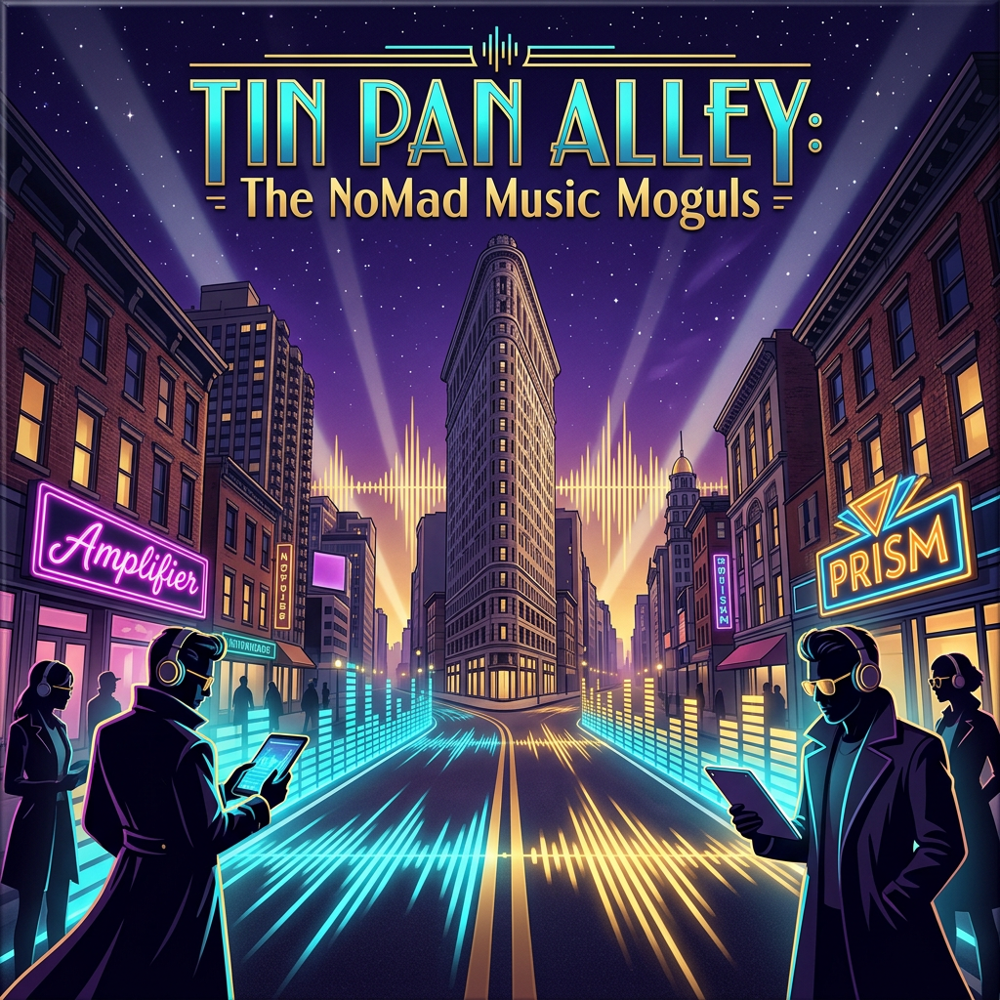
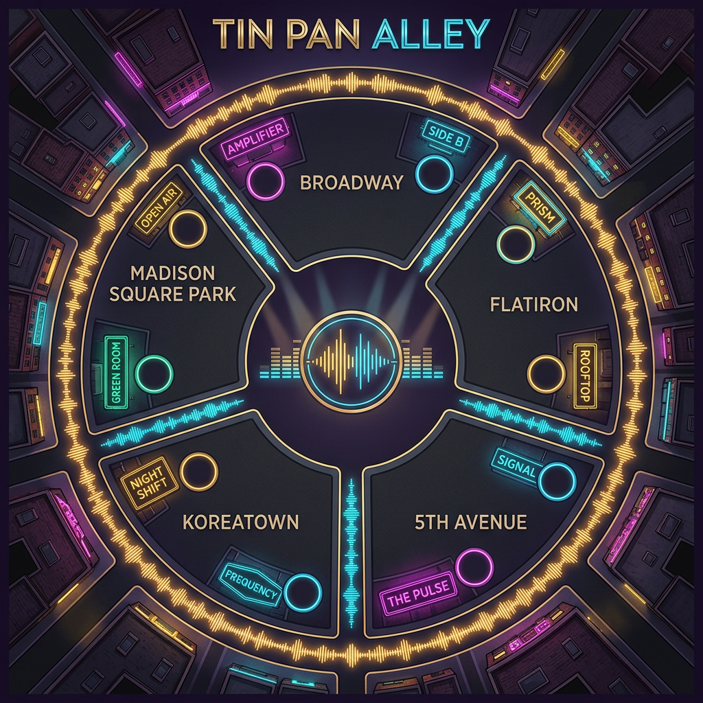

# TIN PAN ALLEY: The NoMad Music Moguls

<p align="center">
  
  
</p>

<p align="center">
  <strong>Autore / Auteur:</strong> Giuseppe Vincenzi<br>
  <strong>Giocatori / Joueurs:</strong> 3–8 | <strong>Durata / Durée:</strong> 45–60 min | <strong>Età / Âge:</strong> 14+<br>
  <strong>Genere / Genre:</strong> Gioco da tavolo ibrido (Mappa + Web-App) / Jeu de société hybride (Plateau + Web-App)
</p>

<p align="center">
  <a href="https://inmediart.ovh/algorhythm/"><strong>▶ Avvia The Algorhythm (Web-App)</strong></a> •
  <a href="#italiano">🇮🇹 Italiano</a> •
  <a href="#français">🇫🇷 Français</a>
</p>

---

<a name="italiano"></a>
## 🇮🇹 Italiano

> *"Scopri il talento. Accendi i club. Conquista la scena."*

### Cos'è Tin Pan Alley?
Nel leggendario quartiere di **NoMad (Manhattan)**, dove a cavallo del Novecento nacque l'industria discografica lungo la celebre *Tin Pan Alley*, una nuova generazione di impresari musicali compete per il dominio dei palchi cittadini.

**Tin Pan Alley** è un gioco da tavolo moderno e ibrido che fonde **strategia manageriale da tavolo** (controllo dell'area, aste al buio, gestione della liquidità in **Beats - BT**) ed **esperienza party/trivia musicale dal vivo**.

Il gioco è orchestrato da **"The Algorhythm"**, una Web-App in **Java 21 / Spring Boot** che si interfaccia con le API di **Deezer** (playlist preconfigurate o playlist personalizzate incollate al volo dall'Host). L'IA funge da DJ neutrale, gestisce il cronometro e convalida le risposte dei blind test tramite correttore intelligente (*Fuzzy Matching*): **nessun giocatore deve sacrificarsi nel ruolo di moderatore, tutti giocano al 100% del tempo.**

### Caratteristiche Principali
* **Zero Tempi Morti (No Downtime):** Tutti i giocatori partecipano contemporaneamente a ogni brano musicale digitando le risposte sul proprio smartphone.
* **La Formula "Trendsetter":** Guadagni se proponi brani raffinati che solo una parte del tavolo sa riconoscere. Troppo facile? Guadagni zero. Troppo difficile? Locale deserto!
* **Economia Dinamica in Beats (BT):** Acquisisci licenze sui club di NoMad (come *Amplifier* o *Prism*), incassa royalty dai rivali e punta sulla *Scommessa sulla Hit*.
* **Nessuna Eliminazione:** Il sistema dello *Scout Freelance* permette a chi va al verde di restare in gara fino al festival finale dei **NoMad Music Awards**.
* **Kit Print & Play Completo:** Tutti i componenti fisici (pedine, gettoni da 25 mm, banconote, schede e tabellone 38×38 cm diviso in 4× A4) includono la modalità **Ink-Friendly** per la stampa casalinga.

📖 **[LEGGI IL REGOLAMENTO COMPLETO IN ITALIANO](rules/regolamento_IT.md)**  
🎧 **[APRI LA WEB-APP THE ALGORHYTHM](https://inmediart.ovh/algorhythm/)**

---

<a name="français"></a>
## 🇫🇷 Français

> *"Dénichez le talent. Enflammez les clubs. Conquérez la scène musicale."*

### Qu'est-ce que Tin Pan Alley ?
Dans le quartier emblématique de **NoMad à Manhattan**, berceau historique de l'industrie du disque le long de la légendaire *Tin Pan Alley*, une nouvelle génération de managers s'affronte pour régner sur les scènes live de la ville.

**Tin Pan Alley** est un jeu de société hybride et contemporain combinant **gestion stratégique sur plateau** (contrôle de zones, enchères secrètes, investissements en **Beats - BT**) et **blind tests musicaux en streaming réel**.

Toute la partie musicale est orchestrée par **"The Algorhythm"**, une application web en **Java 21 / Spring Boot** connectée à l'API **Deezer** (playlists thématiques ou playlist personnalisée collée à la volée par l'hôte). L'IA agit comme DJ impartial, chronométreur et arbitre grâce à un correcteur intelligent (*Fuzzy Matching*) : **aucun joueur n'est contraint de jouer le rôle passif de maître de jeu ou DJ ; tout le monde participe activement.**

### Points Forts
* **Zéro Temps Mort :** Tous les participants jouent simultanément sur chaque morceau via leur smartphone.
* **Le Dilemme du "Trendsetter" :** Pour maximiser vos revenus lors de vos soirées club, choisissez des artistes pointus mais accessibles. Un titre trop évident ou trop obscur ne vous rapportera rien !
* **Économie & Contrôle de Quartier :** Prenez le contrôle des clubs phares de NoMad (*Amplifier*, *Prism*...), encaissez les royalties de vos rivaux et pariez sur les hits en direct.
* **Aucune Élimination :** Le statut de *Scout Freelance* protège les joueurs en difficulté financière et garantit une course au score ouverte jusqu'au gala final des **NoMad Music Awards**.
* **Kit Print & Play Complet :** Tous les éléments physiques (pions, jetons 25 mm, billets, fiches et plateau 38×38 cm en 4× A4) disposent d'un mode **Ink-Friendly** pour l'impression maison.

📖 **[LIRE LE RÈGLEMENT COMPLET EN FRANÇAIS](rules/reglement_FR.md)**  
🎧 **[OUVRIR L'APP WEB THE ALGORHYTHM](https://inmediart.ovh/algorhythm/)**

---

## 🗂️ Struttura del Repository / Structure du Dépôt

```text
├── assets/
│   ├── box_cover.png           # Concept art della scatola / Visuel de la boîte
│   ├── board.png               # Tabellone Notturno / Plateau Nocturne
│   └── board_ink.png           # Tabellone Ink-Friendly / Plateau Ink-Friendly
├── print-and-play/             # Componenti stampabili A4 (IT / FR + Ink-Friendly)
│   ├── 01_pedine_e_gettoni.html
│   ├── 02_beats_banconote.html
│   ├── 03_schede_management.html
│   ├── 04_tabellone.html
│   ├── css/
│   └── js/
├── rules/                      # Regolamenti completi / Livrets de règles complets
│   ├── regolamento_IT.md
│   └── reglement_FR.md
├── app/                        # Backend Java 21 / Spring Boot + WebSocket (The Algorhythm)
├── index.html                  # Landing page bilingue (IT / FR)
├── landing.css
├── translations.js
└── README.md                   # Questo file / Ce fichier
```

---

## 🎯 Intenti del Progetto / Intentions du Projet

**🇮🇹** **Tin Pan Alley** è un progetto hobbistico: **gratuito, open source e senza scopo di lucro**. Nasce per portare sul tavolo l'emozione del music quiz insieme alla strategia della gestione economica, ed è condiviso nella speranza che altri appassionati e designer possano provarlo, giocarlo e contribuire a migliorarlo.

Nessun componente di questo progetto è venduto, né è previsto alcun meccanismo di monetizzazione: nessuna pubblicità, nessun paywall, nessuna sponsorizzazione.

**🇫🇷** **Tin Pan Alley** est un projet amateur : **gratuit, open source et à but non lucratif**. Il est né pour apporter sur la table l'émotion du blind test musical associée à la stratégie d'un jeu de gestion, et est partagé dans l'espoir que d'autres passionnés et créateurs puissent le découvrir, y jouer et contribuer à l'améliorer.

Aucun élément de ce projet n'est vendu, et aucun mécanisme de monétisation n'est prévu : pas de publicité, pas de paywall, pas de sponsoring.

---

## 🎵 Musica e Contenuti di Terze Parti / Musique et Contenus Tiers

**🇮🇹**

- I brani ascoltati durante il gioco sono **anteprime ufficiali di 30 secondi** riprodotte in streaming tramite la **Deezer Developer API**, utilizzata in conformità con i suoi termini d'uso per finalità strettamente **non commerciali** ([developers.deezer.com](https://developers.deezer.com/)).
- **Nessun file audio è scaricato, salvato o ridistribuito** da questa applicazione: i preview vengono trasmessi in streaming solo durante la partita e non sono accessibili come file.
- Titoli, nomi di artisti, copertine e tutti i contenuti musicali restano **proprietà esclusiva dei rispettivi titolari di diritti** (etichette, editori, artisti). La licenza open source di questo progetto copre **esclusivamente il codice e i materiali originali**, non i contenuti musicali.
- Deezer è un marchio di Deezer S.A.; questo progetto non è affiliato, sponsorizzato né approvato da Deezer o da alcun titolare di diritti musicali.

**🇫🇷**

- Les morceaux écoutés pendant la partie sont des **extraits officiels de 30 secondes** diffusés en streaming via la **Deezer Developer API**, utilisée conformément à ses conditions d'utilisation à des fins strictement **non commerciales** ([developers.deezer.com](https://developers.deezer.com/)).
- **Aucun fichier audio n'est téléchargé, stocké ou redistribué** par cette application : les extraits sont diffusés en streaming uniquement pendant la partie et ne sont pas accessibles comme fichiers.
- Titres, noms d'artistes, pochettes et tout contenu musical demeurent la **propriété exclusive de leurs titulaires de droits** (labels, éditeurs, artistes). La licence open source de ce projet couvre **exclusivement le code et les documents originaux**, pas les contenus musicaux.
- Deezer est une marque de Deezer S.A. ; ce projet n'est ni affilié, ni sponsorisé, ni approuvé par Deezer ou par un quelconque titulaire de droits musicaux.

---

## ⚠️ Limiti d'Uso / Limites d'Utilisation

**🇮🇹**

Questo progetto è pensato per l'**uso privato tra amici**, in contesti domestici e non commerciali. In particolare:

- **Eventi pubblici** (club, fiere, serate a pagamento, demo in negozi): la riproduzione di musica in luogo pubblico richiede le licenze previste dalla legge (in Italia SIAE, in Francia SACEM). È responsabilità dell'organizzatore dell'evento, non di questo progetto.
- **Uso commerciale**: i termini delle API di streaming consentono l'uso solo in ambiente non commerciale. Qualsiasi impiego commerciale della web-app o del gioco esula dai termini di questo progetto e richiederebbe accordi diretti con i titolari dei diritti.
- **Continuità del servizio**: l'accesso alla Deezer API può essere modificato o revocato dalla piattaforma in qualsiasi momento; la disponibilità della componente musicale non è garantita.
- **Nessuna garanzia**: il progetto è fornito "così com'è", senza alcuna garanzia, come da licenza open source adottata.

**🇫🇷**

Ce projet est conçu pour un **usage privé entre amis**, dans un cadre domestique et non commercial. En particulier :

- **Événements publics** (clubs, festivals, soirées payantes, démonstrations en boutique) : la diffusion de musique dans un lieu public requiert les licences prévues par la loi (en Italie SIAE, en France SACEM). C'est la responsabilité de l'organisateur de l'événement, pas de ce projet.
- **Usage commercial** : les conditions des API de streaming autorisent uniquement un usage non commercial. Toute exploitation commerciale de la web-app ou du jeu sort du cadre de ce projet et nécessiterait des accords directs avec les titulaires de droits.
- **Continuité du service** : l'accès à la Deezer API peut être modifié ou révoqué par la plateforme à tout moment ; la disponibilité de la composante musicale n'est pas garantie.
- **Aucune garantie** : le projet est fourni « en l'état », sans aucune garantie, conformément à la licence open source adoptée.

---

## ⚖️ Licenza & Crediti / Licence & Crédits

*   **Game Design & Concept:** Giuseppe Vincenzi
*   **Codice sorgente / Code source:** licenza **MIT** (vedi file [LICENSE](LICENSE))
*   **Regolamenti e materiali print & play / Règlements et composants print & play:** **CC BY-SA 4.0**
*   **Esclusione / Exclusion:** i contenuti musicali (brani, anteprime, copertine) trasmessi via Deezer API restano di proprietà dei rispettivi titolari e non sono coperti da queste licenze. / Les contenus musicaux (morceaux, extraits, pochettes) diffusés via la Deezer API demeurent la propriété de leurs titulaires respectifs et ne sont pas couverts par ces licences.